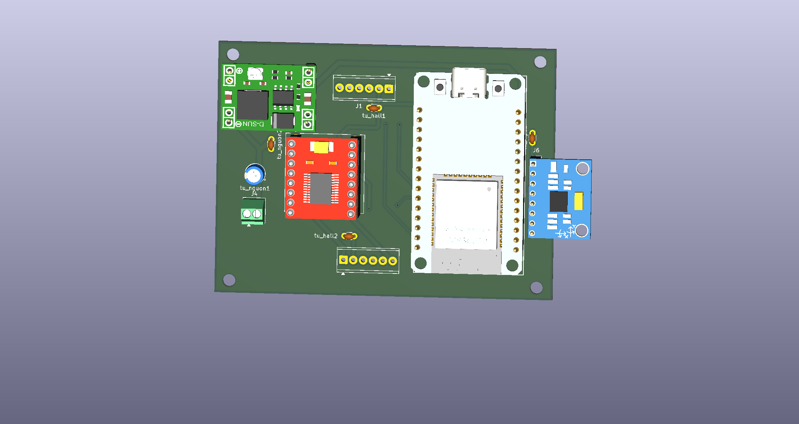
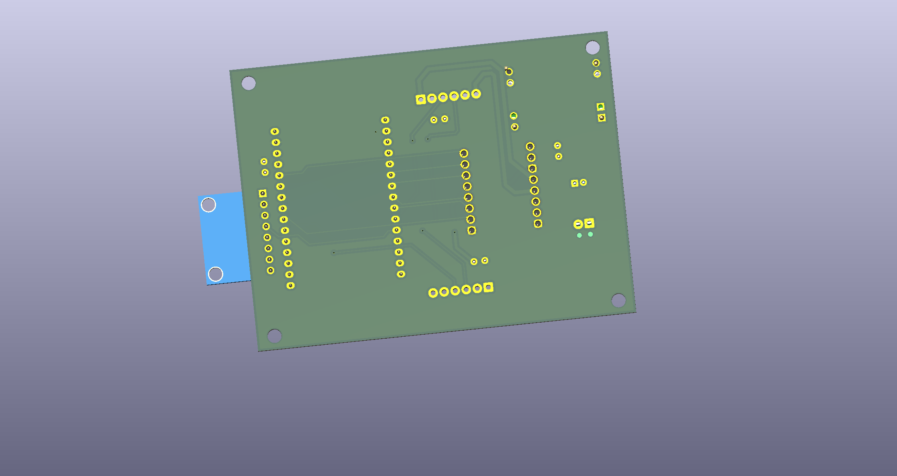

# ESP32-Self-Balancing-Robot
A two-wheeled self-balancing robot built with ESP32, MPU6050 IMU, DC motors, and encoder feedback. Focused on sensor fusion, state estimation, and feedback control.
## Hardware Design

### PCB 3D Preview

### Circuit Schematic

[View Schematic (PDF)](hardware/export/self-balancing.kidcad_sch)

### PCB Layout

[Top Layer](hardware/export/self-balancing-Front.svg) |
[Bottom Layer](hardware/export/self-balancing-Back.svg)  

### KiCad Source Files

[View KiCad Project](hardware/kicad/)
