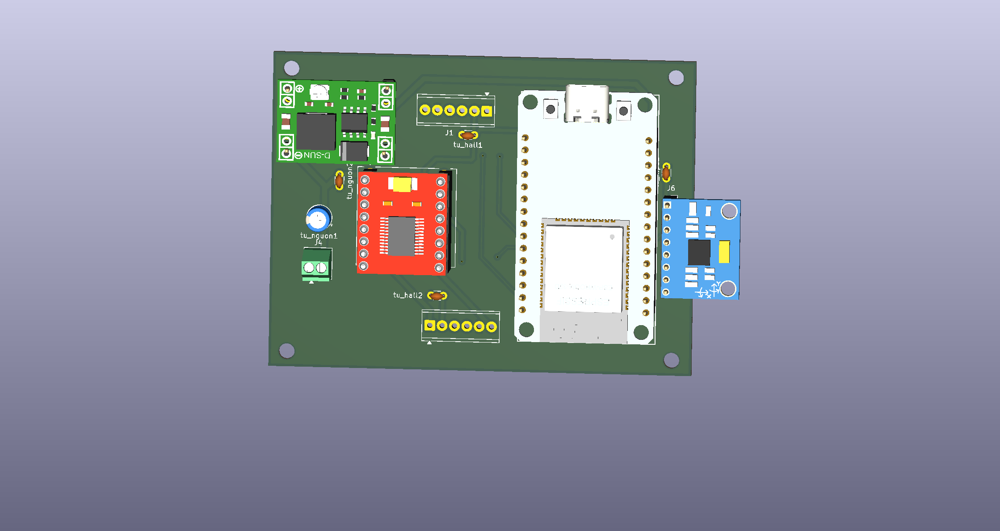
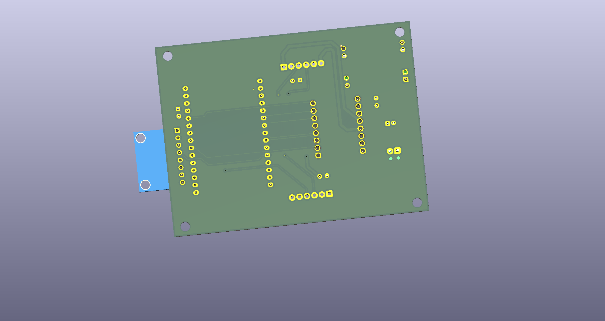

# ESP32-Self-Balancing-Robot
A two-wheeled self-balancing robot built with ESP32, MPU6050 IMU, DC motors, and encoder feedback. Focused on sensor fusion, state estimation, and feedback control.
## Hardware Design

### PCB 3D Preview

### Circuit Schematic

[View Schematic (PDF)](hardware/export/self-balancing.pdf)

### PCB Layout

[Top Layer](hardware/export/self-balancing-Front.svg) |
[Bottom Layer](hardware/export/self-balancing-Back.svg)  

### KiCad Source Files

[View KiCad Project](hardware/kicad/)

## Firmware Control

The web PID tuner is implemented in `firmware/src/web_tune.cpp`, but it is not
started by the current `firmware/src/main.cpp`; the current firmware does not
start a Wi-Fi access point. Before enabling the tuner, set a private network
name and a unique password in `web_tune.cpp`. The server refuses to start while
the password placeholder is unchanged. Web-tuned gains are not saved across a
reset.

The balance controller defaults are Kp=16, Ki=100, and Kd=0.8 in
`firmware/src/pid.cpp`. The encoder position/speed outer loop samples at 20 Hz
and is disabled by default in `firmware/include/config.h`. Verify both encoder
directions and tune the outer-loop gains with the robot safely supported before
enabling it.
